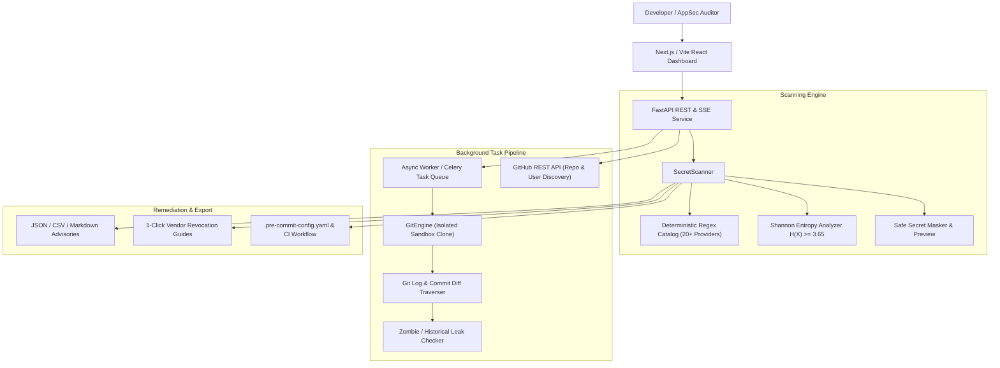

# 🛡️ SecretShield — Instant Git Secret & API Key Leak Auditor

> **Shift-Left Application Security (AppSec) & DevSecOps Platform**  
> Audit Git commit histories, repositories, user profiles, and configuration blocks for exposed AWS credentials, OpenAI keys, Stripe secrets, private keys, and database connection strings using a dual-engine architecture: **Deterministic Regex + Shannon Entropy ($H$) Heuristics**.

---

## 🌟 The Real-World Problem & Solution

Developers frequently commit `.env` files, API credentials, and database connection strings to public repositories. When they realize the mistake, they often commit an update removing the key—**leaving the credential permanently exposed in git history (`git log`) where automated scanners and threat actors harvest it**.

**SecretShield solves this by:**
1. **Three Scanning Interfaces:**
   - **Public GitHub Repository URL:** Clones repository, extracts patch diffs (`git log`, `git show`), and analyzes commit trees for secrets.
   - **GitHub User / Org Profile:** Leverages GitHub REST API to discover public repositories with star counts, languages, and 1-click audit buttons.
   - **Raw Code & Config Paste:** Instant synchronous auditing of pasted `.env`, YAML, Python, or shell scripts.
2. **Dual-Engine Detection:**
   - **High-Fidelity Regex Catalog:** 20+ pre-compiled pattern rules covering AWS, OpenAI, Anthropic, Gemini, Stripe, GitHub PATs, Slack, HuggingFace, DB URIs, and Private Keys.
   - **Shannon Entropy Analysis:** Computes $H(X) = -\sum P(x)\log_2 P(x)$ to catch unidentified high-entropy random cryptographic tokens and passwords that bypass static regex.
3. **Leak Severity & Exposure Dashboard:**
   - Calculates a 0–100 **Security Health Index** score with severity penalty weighting.
   - Categorizes findings by **CRITICAL**, **HIGH**, **MEDIUM**, and **LOW** risk.
   - **Historical "Zombie" Secret Detection:** Flags whether a secret is active in the latest HEAD or has been deleted in newer commits yet remains accessible in past git objects!
4. **1-Click Revocation & Rotation Guides:**
   - Vendor-specific rotation links (AWS IAM, OpenAI Platform, Stripe Dashboard, GitHub Settings).
   - Copy-paste terminal remediation commands (`aws iam delete-access-key`, Stripe CLI, DB password changes).
   - Git History Eradication commands (`git filter-repo`) to purge leaked secrets from history before force-pushing.
5. **Downloadable `.pre-commit-config.yaml` & CI Pipeline:**
   - Generates custom pre-commit hooks (Gitleaks, Yelp detect-secrets, `.env` file blocker) tailored to detected risks.
   - Generates `.github/workflows/secret-scan.yml` to prevent future leaks in pull requests.

---

## 🏗️ Architecture & Tech Stack



- **Backend:** Python 3.14+, FastAPI, Uvicorn, Pydantic, HTTPX, SSE-Starlette, Celery & Redis task architecture.
- **Frontend:** React 18, TypeScript, Vite, Tailwind CSS, Lucide Icons, Server-Sent Events (SSE) streaming progress.
- **Security:** Zero plaintext secret exposure in logs or UI; all tokens are safely masked (`AKIAIOSFODNN7E*******`).

---

## 🚀 Quick Start

### 1. Automatic One-Click Launch (Windows PowerShell)
```powershell
.\start.ps1
```
This script initializes the Python virtual environment, installs dependencies, and launches both backend and frontend servers.

### 2. Manual Startup

#### Backend (Terminal 1)
```powershell
cd backend
python -m venv .venv
.\.venv\Scripts\pip install -r requirements.txt
.\.venv\Scripts\python -m uvicorn app.main:app --host 127.0.0.1 --port 8000 --reload
```
API Documentation will be live at: **http://127.0.0.1:8000/docs**

#### Frontend (Terminal 2)
```powershell
cd frontend
npm install
npm run dev -- --host 127.0.0.1 --port 5173
```
Dashboard will be live at: **http://127.0.0.1:5173**

### 3. Deploy to Hugging Face Spaces (100% Free, 16 GB RAM, Always-On)

SecretShield is pre-configured with Hugging Face Space Docker metadata.

1. Go to [Hugging Face Spaces](https://huggingface.co/spaces) and click **Create new Space**.
2. Set:
   - **Space Name:** `secretshield`
   - **License:** `apache-2.0` or `mit`
   - **Space SDK:** Choose **Docker** -> **Blank**
   - **Space Hardware:** Free (2 vCPU, 16 GB RAM)
3. Clone your new Space repository or add it as a git remote:
   ```bash
   git remote add space https://huggingface.co/spaces/<YOUR-USERNAME>/secretshield
   git push space master:main
   ```
4. Hugging Face automatically detects the Dockerfile, installs Git and Python dependencies, builds the Vite frontend, and starts the service on port `7860`.
5. Your auditor will be live 24/7 with zero spin-down at: `https://huggingface.co/spaces/<YOUR-USERNAME>/secretshield`

---

## 🧪 Running Unit Tests

Run the backend test suite:
```powershell
cd backend
.\.venv\Scripts\python -m pytest tests
```
Tests cover:
- Shannon Entropy mathematical boundary calculations
- Regex rule matches (AWS, OpenAI, Anthropic, Stripe, DB URIs)
- Secret masking and end-to-end scanner pipeline

---

## 📊 API Reference

| Method | Endpoint | Description |
| :--- | :--- | :--- |
| `POST` | `/api/scan/snippet` | Synchronous scan of code / config snippets |
| `POST` | `/api/scan/repo` | Asynchronous background cloning & git commit audit |
| `POST` | `/api/scan/user` | Fetch public repositories for a GitHub user/organization |
| `GET` | `/api/scan/{scan_id}` | Retrieve full audit findings and summary metrics |
| `GET` | `/api/scan/{scan_id}/progress` | Retrieve current status and progress percentage |
| `GET` | `/api/scan/{scan_id}/events` | Server-Sent Events (SSE) live progress stream |
| `POST` | `/api/precommit/generate` | Generate `.pre-commit-config.yaml` & GitHub Actions CI workflow |
| `GET` | `/api/scan/{scan_id}/export/{format}` | Export report as `json`, `csv`, or `markdown` advisory |
| `GET` | `/api/health` | Service health status |

---

## 🛡️ Shannon Entropy Formula

Shannon entropy measures the uncertainty or information density in a sequence of characters:

$$H(X) = -\sum_{i=1}^{n} P(x_i) \log_2 P(x_i)$$

Where:
- $n$ is the number of distinct characters in the token.
- $P(x_i)$ is the probability (relative frequency) of character $x_i$.
- Natural English and code variables average **2.0 – 3.2 bits/symbol**.
- Cryptographic keys and random API tokens score **≥ 3.65 – 5.5 bits/symbol**.
