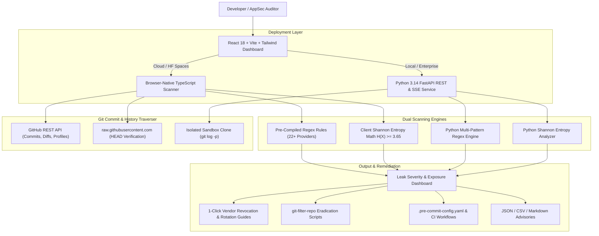

# 🛡️ SecretShield — Instant Git Secret & API Key Leak Auditor

<div align="center">

[](https://huggingface.co/spaces/akhilbinu/secretshield)
[](https://akhilbinu-secretshield.static.hf.space)
[](https://github.com/Akhil-Binu/SecretShield)
[](LICENSE)

<p align="center">
  <b>Shift-Left Application Security (AppSec) & DevSecOps Platform</b><br>
  Audit public GitHub repositories, commit histories, user profiles, and raw configuration blocks for exposed API keys, cloud tokens, database connection strings, and private keys before attackers exploit them.
</p>

</div>

---

## 🌟 The Real-World Problem

Developers constantly leak cloud credentials, OpenAI keys, VirusTotal tokens, database connection strings, and `.env` files into public GitHub repositories. When developers realize the mistake, they typically commit a quick fix removing the key—**leaving the credential permanently accessible in past Git commit history (`git log`, `git show`) where automated attacker bots harvest it within seconds**.

Most traditional secret scanners (like TruffleHog or Gitleaks) are command-line-only utilities that developers and security analysts find difficult to configure and visualize.

### The SecretShield Solution
SecretShield provides an **instant, zero-installation web interface** powered by a **Dual-Engine Architecture**:
1. **Deterministic High-Fidelity Regex Catalog:** 22+ rules covering major cloud, AI, and threat intelligence providers.
2. **Shannon Entropy ($H$) Heuristics:** Mathematical randomness calculation ($H \ge 3.65$) catching obfuscated, high-entropy tokens and passwords that bypass standard static regex.
3. **Dual-Mode Deployment:** Runs either as a full **FastAPI + Celery/Redis** server backend or as a **100% Browser-Native Static App** hosted freely on platforms like Hugging Face Spaces and GitHub Pages!

---

## 🚀 Live Deployments

| Environment | URL | Engine | Status |
| :--- | :--- | :--- | :--- |
| **Hugging Face Spaces** | [huggingface.co/spaces/akhilbinu/secretshield](https://huggingface.co/spaces/akhilbinu/secretshield) | Browser Engine (`sdk: static`) | 🟢 Live (24/7 Always-On) |
| **Direct Web App** | [akhilbinu-secretshield.static.hf.space](https://akhilbinu-secretshield.static.hf.space) | Browser Engine | 🟢 Live |
| **Local Deployment** | `http://127.0.0.1:5173` | FastAPI + React (Dual) | 💻 Developer Setup |

---

## 🔑 Core Features

### 1. Multi-Mode Ingestion
- **Public Git Repository Audit:** Enter any GitHub repository URL (e.g. `https://github.com/owner/repo` or `owner/repo`) with configurable commit history depth (20, 50, or 100 commits).
- **Dedicated Credential Files Audit in HEAD:** Directly checks root key files (`VirusTotal_APIKey.txt`, `api_key.txt`, `.env*`, `config.json`, etc.) in the active repository tree.
- **GitHub User & Organization Discovery:** Enter any GitHub handle (e.g. `@octocat`, `@torvalds`) to list all public repositories with language tags, star counts, and 1-click audit triggers.
- **Instant Code & Config Paste:** Audit `.env`, YAML, Python, Bash, or JSON snippets with zero latency.
- **Drag-and-Drop File Upload:** Inspect local configuration files before committing to Git.

### 2. Historical "Zombie Secret" Detection
- Distinguishes between **🔴 Active Secrets in HEAD** (credentials currently live in the codebase) and **⚠️ Zombie Secrets** (credentials removed in `HEAD`, but permanently exposed in Git commit history objects).
- Ground-truth verified against raw repository content so developers can accurately triage leak exposure.

### 3. Leak Severity & Health Index Dashboard
- **0–100 Security Health Index:** Dynamic score penalizing repositories based on leak severity (Critical: -25, High: -15, Medium: -7, Low: -2).
- **Safe Token Masking:** All secrets are masked (`AKIAIOSFODNN7E*******`, `8ccdaca0...********...12bb`) to prevent accidental shoulder surfing or secondary leaks.
- **Interactive Commit Timeline:** Visual DAG commit path displaying exact commit SHAs, author names, timestamps, and commit messages for every finding.

### 4. 1-Click Remediation & Eradication Guides
- **Vendor-Specific Rotation Guides:** Direct console links to AWS IAM, OpenAI Platform, VirusTotal User Settings, Stripe Dashboard, Anthropic Console, and GitHub Tokens.
- **Git History Purge Generator:** Generates automated `git filter-repo` shell and PowerShell scripts (`purge_secrets.sh`, `purge_secrets.ps1`) to eradicate leaked files across all commit branches before force-pushing.
- **Non-Destructive Live Probes:** Probes token validity (GitHub PAT `/user`, VirusTotal `/v3/users/me`, OpenAI `/v1/models`, Hugging Face `/whoami-v2`, Slack `/auth.test`, Stripe `/v1/balance`).

### 5. Shift-Left Prevention Tools
- **Dynamic `.pre-commit-config.yaml` Generator:** Generates a custom pre-commit hook configuration tailored to the specific leak types found in the audit.
- **Yelp detect-secrets Baseline Exporter:** Generates `.secrets.baseline` files to easily baseline existing projects without breaking CI pipelines.
- **Automated CI/CD Workflow:** Generates `.github/workflows/secret-scan.yml` to block secret leaks on Pull Requests.
- **Multi-Format Advisory Exporter:** 1-click download of findings as **JSON**, **CSV** (for spreadsheets), or **Markdown Executive Security Advisory**.

### 6. GitHub Personal Access Token (PAT) Manager
- Built-in GitHub Token configuration modal with live capacity monitor (`60 req/hr` unauthenticated vs `5,000 req/hr` authenticated).
- **Zero-knowledge:** Stored strictly in the browser's `localStorage` and sent directly to `api.github.com`. No server storage.
- Requires **zero scopes** for public repo audits.

---

## 🛡️ Supported Detection Rules Catalog

SecretShield includes 22+ high-fidelity detection rules with calibrated Shannon entropy thresholds:

| Provider | Pattern / Rule Name | Severity | Min Entropy |
| :--- | :--- | :---: | :---: |
| **AWS** | AWS Access Key ID (`AKIA...`, `ASIA...`) | `CRITICAL` | 2.8 bits |
| **AWS** | AWS Secret Access Key (`40-char base64`) | `CRITICAL` | 4.0 bits |
| **OpenAI** | OpenAI API Key (`sk-proj-...`, `sk-...`) | `CRITICAL` | 3.8 bits |
| **Anthropic** | Anthropic Claude Key (`sk-ant-...`) | `CRITICAL` | 3.8 bits |
| **Google Cloud** | Gemini & GCP API Key (`AIza...`) | `HIGH` | 3.8 bits |
| **VirusTotal** | Threat Intelligence API Key (`64-hex`) | `CRITICAL` | 3.5 bits |
| **GitHub** | Classic Personal Access Token (`ghp_...`) | `CRITICAL` | 3.8 bits |
| **GitHub** | Fine-Grained Token (`github_pat_...`) | `CRITICAL` | 4.0 bits |
| **GitHub** | OAuth & App Tokens (`gho_`, `ghu_`, `ghs_`) | `HIGH` | 3.8 bits |
| **Stripe** | Secret / Restricted Key (`sk_live_...`, `rk_live_...`) | `CRITICAL` | 3.7 bits |
| **Databases** | Postgres, MySQL, MongoDB, Redis, MSSQL URIs | `CRITICAL` | 2.8 bits |
| **Crypto** | RSA, OpenSSH, EC Private Key Blocks | `CRITICAL` | 2.5 bits |
| **Slack** | Bot & User OAuth Tokens (`xoxb-...`, `xoxp-...`) | `HIGH` | 3.5 bits |
| **Hugging Face** | User Access Token (`hf_...`) | `HIGH` | 3.8 bits |
| **Twilio** | Account SID & Auth Token (`AC...`) | `HIGH` | 3.2 bits |
| **SendGrid** | Mail API Key (`SG...`) | `HIGH` | 4.1 bits |
| **Discord** | Bot Authorization Token | `HIGH` | 4.0 bits |
| **Security** | Generic Hexadecimal API Key (`32–64 hex`) | `HIGH` | 3.3 bits |
| **Auth** | Signed JSON Web Tokens (`eyJ...`) | `MEDIUM` | 4.2 bits |
| **Config** | Hardcoded Password Assignment in `.env` | `HIGH` | 3.2 bits |

---

## 🧮 Shannon Entropy Formula

Shannon entropy measures the uncertainty or information density in an arbitrary sequence of characters:

$$H(X) = -\sum_{i=1}^{n} P(x_i) \log_2 P(x_i)$$

Where:
- $n$ is the number of distinct characters in the token.
- $P(x_i)$ is the probability (relative frequency) of character $x_i$.
- Natural English and code variables average **2.0 – 3.2 bits/symbol**.
- Cryptographic keys, API tokens, and secure passwords score **≥ 3.65 – 5.5 bits/symbol**.

---

## 🏗️ Architecture



---

## 💻 Local Development Setup

### 1. One-Click Startup (PowerShell)
```powershell
.\start.ps1
```
This script automatically sets up the Python virtual environment, installs backend and frontend dependencies, and boots both servers concurrently.

### 2. Manual Startup

#### Backend (Terminal 1)
```powershell
cd backend
python -m venv .venv
.\.venv\Scripts\pip install -r requirements.txt
.\.venv\Scripts\python -m uvicorn app.main:app --host 127.0.0.1 --port 8000 --reload
```
* Interactive API Documentation (Swagger / OpenAPI): **http://127.0.0.1:8000/docs**

#### Frontend (Terminal 2)
```powershell
cd frontend
npm install
npm run dev -- --host 127.0.0.1 --port 5173
```
* Live Application Dashboard: **http://127.0.0.1:5173**

---

## 🧪 Testing

Run the automated backend pytest suite:
```powershell
cd backend
.\.venv\Scripts\python -m pytest tests
```

Run frontend production build verification:
```powershell
cd frontend
npm run build
```

---

## 📄 License

Distributed under the **MIT License**. See [`LICENSE`](LICENSE) for more information.

Developed by **[Akhil Binu](https://github.com/Akhil-Binu)**.
